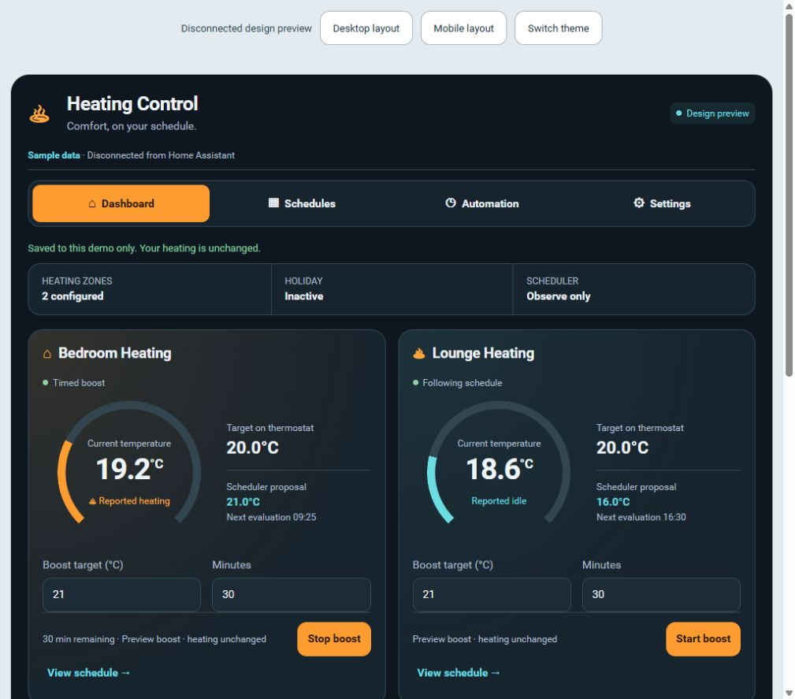

# Smart Heating Scheduler Card - Phase 3 development candidate

A self-contained Lovelace custom card following the approved orange/teal designs. Rounded thermostat panels, HA-aware dark/light themes, side-by-side desktop zones and stacked mobile controls. No runtime CDN or third-party card dependency.



## Install through HACS / Marketplace

Add `https://github.com/OneScuzzie2k/smart-heating-scheduler-card` as a custom **Dashboard** repository and download it. Install [the backend integration](https://github.com/OneScuzzie2k/smart-heating-scheduler) separately as an **Integration** repository. On HA 2026.11, use Settings > Marketplace. Choose the default branch for this initial development preview if no release is listed.

Allow the Marketplace/HACS to register the JavaScript resource, then reload the browser. For YAML-managed resources, follow the resource path/type shown in its install dialog. Add Smart Heating Scheduler in the dashboard card picker, choose the config entry and confirm **Observe only**. No real heating command is sent in that mode.

## Try it

Open preview.html from the development test package. It is disconnected, uses sample data and resets on reload. Try boost start/stop on Dashboard; Home/Away overrides and holiday on Automation; boost adapter settings under Settings. Advance demo clock 30 minutes on Automation to see expiry. The demo models manual overrides and timed controls; actual sensor aggregation runs in the HA backend and is covered by backend tests.

## Working controls

Mini card: choose **Mini thermostat & boost** in the visual card editor, then select a scheduler and heating zone. The compact layout follows Home Assistant's thermostat: a round interactive dial, current room temperature, boost-time slider and one Boost/Stop boost button. The dial is the only target-temperature control. Drag its handle or tap its arc; releasing sends one manual-target change. Arrow keys adjust by one temperature step; Home/End choose the bounds. A cancelled drag sends nothing. A small Resume schedule control appears during a manual override. Tap the title to open the configured full dashboard, or the three-dot button for the native thermostat. Test the disconnected example at `/mini` on the local demo server.

```yaml
type: custom:smart-heating-scheduler-card
layout: mini
entry_id: YOUR_CONFIG_ENTRY_ID
zone_id: YOUR_ZONE_SUBENTRY_ID
title: Bedroom Heating
dashboard_path: /your-heating-dashboard
theme: auto
```

The mini dial sends the native thermostat temperature action only when live control is enabled, the zone is available and no boost/holiday handover is active. The backend observes it as a manual target change under the zone's configured hold policy. It never switches on an Off thermostat implicitly. Use the native thermostat or full scheduler to turn heating on from Off. Boosts use the existing backend API, ownership guards and helper duration constraints.

**Occupancy override** is a per-zone setting under Settings (also available on Automation). Enable it, choose an occupied minimum, people or occupancy sensors, active weekdays and hours, then save. It raises a lower scheduled target while occupied; a higher scheduled target is retained. Manual holds, Off, boost and holiday keep their priority. Disabling clears the minimum; occupancy selections, days and hours remain.

Enabled rules appear alongside today's schedule and the phone day editor, with a conditional teal strip under each applicable weekday timeline. The display distinguishes Active, waiting for occupancy, unknown occupancy, outside active hours and another control taking priority. The strip describes the conditional rule; it does not claim someone is home on future days.

- Dashboard measurements/device targets/proposals stay distinct, with control-source explanations and boost countdowns.
- Weekly schedule editor: desktop timelines, phone day/period list, explicit time/target/label editor, split/delete, day/week copy, undo, save/cancel and revision conflicts.
- Boost target/duration/start/cancel with backend capability checks and acknowledged holiday exceptions.
- Presence selection, explicit Home/Away states, any/all, configurable delays/unknown fallback, occupied comfort window and expiring manual overrides.
- Holiday start/return in HA local time, per-zone target, conflict behaviour and cancellation. DST gaps/repeated-hour input is rejected clearly.
- Adapter settings for built-in boost or fixed-target external scripts, timer, optional helper and filtered completion event.
- Connected mode shows Observe only or Heating control explicitly. Admin mutation controls and policy revisions are enforced by the backend.

Use Settings > Heating control mode only in a reviewed test environment. Enabling it permits real climate/script/helper calls; it requires the exact acknowledgement shown in the UI. It is disabled in the disconnected demo. Test the browser preview without changing live HA.

## Development

```powershell
npm ci
npm run build
npm test
npm run demo
```

Local demo: http://127.0.0.1:18765/. Distribution bundle: dist/smart-heating-scheduler-card.js. The same compiled custom element is used in the preview and HA.

```yaml
type: custom:smart-heating-scheduler-card
entry_id: YOUR_CONFIG_ENTRY_ID
title: Heating Control
theme: auto
view: dashboard
```

The visual card editor selects entry/title/theme/view. Leave demo out for connected data. Browser clocks are for display only; the backend owns real deadlines and commands. No HA URL/token or home mapping is embedded in sample previews.

Full HA browser installation, physical devices, screen readers, 200% zoom, broader themes and translations still require release validation. Development source is prepared for public GitHub custom-repository installation; it is not a catalog-listed stable release or a production deployment. MIT licensed. Bulk holiday scope and defaults/inheritance remain follow-up work; current smart rules are independent per zone.
