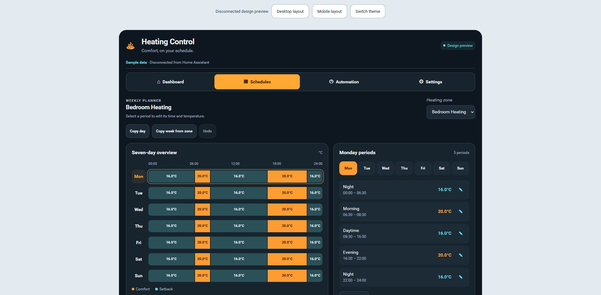
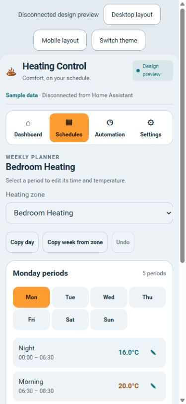
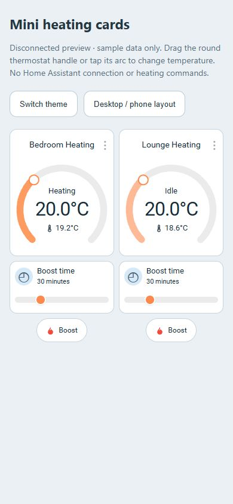

# Smart Heating Scheduler Card

**Test release 0.4.0-dev.1** adds calendar/Workday profile forms, a History tab
with temperature and decision timelines, and optional smart-preheating settings.
Requires backend 0.4.0.dev1 for these features. Existing mini thermostat layout is
preserved. This is an opt-in prerelease; 0.3.0 remains the stable card release. See the backend
[feature guide](https://github.com/OneScuzzie2k/smart-heating-scheduler/blob/main/docs/PROFILES_HISTORY_PREHEATING.md)
for feature setup and validation limits. Card Settings has an Add heating zone shortcut to Home Assistant zone setup.


A companion Lovelace card for [Smart Heating Scheduler](https://github.com/OneScuzzie2k/smart-heating-scheduler), with a full weekly planner and a compact thermostat/boost layout. Supports desktop, tablet and phone layouts, plus Home Assistant light/dark themes.

**Stable release:** [card 0.3.0](https://github.com/OneScuzzie2k/smart-heating-scheduler-card/releases/tag/0.3.0), compatible with [integration 0.3.1](https://github.com/OneScuzzie2k/smart-heating-scheduler/releases/tag/0.3.1). Requires **Home Assistant Core 2026.11.1 or newer**. The integration and card are installed separately. The backend patch fixes legacy timer migration and reload cleanup; no card update is needed. This card promotes the tested dev.5 frontend without layout or heating-command changes; see [acceptance scope](https://github.com/OneScuzzie2k/smart-heating-scheduler/blob/main/docs/RELEASE_ACCEPTANCE.md).

**[Full installation and setup guide](https://github.com/OneScuzzie2k/smart-heating-scheduler/blob/main/docs/INSTALLATION.md)** - zone setup, schedules, boost choices, occupancy, heating-control handover, updates and rollback.

No additional custom card, separate add-on, runtime CDN or end-user Node.js installation is required. Your thermostat's existing HA integration is still required.

## Screenshots

Desktop and phone layouts from the working 0.3.0 card. These screenshots use sample data, disconnected from Home Assistant.

**Desktop weekly planner**



| Mobile schedule editor | Mini thermostat and boost cards |
| --- | --- |
|  |  |

[View the full dashboard screenshot](docs/screenshots/dashboard-desktop.jpg). Choose Full scheduler or Mini thermostat & boost in the visual card editor; both use the same installed card resource.

## Install through Marketplace

1. In **Settings > Marketplace**, choose **Add from link** and add:
   `https://github.com/OneScuzzie2k/smart-heating-scheduler-card`.
   Check that the repository is shown as type **Dashboard**.
2. Select stable **0.3.0**; use **Install another version** if needed. Install the card. Include pre-releases is not required.
3. Install [the backend repository](https://github.com/OneScuzzie2k/smart-heating-scheduler) separately as type **Integration**, version **0.3.1**. Follow its restart prompt. Under **Settings > Devices & services**, add **Smart Heating Scheduler (Preview)**, then **Add heating zone** for each thermostat.
4. Allow Marketplace to register the JavaScript resource, then reload your browser or Companion App frontend. For YAML-managed resources, add the module entry shown in the install dialog. Register it once.
5. On an editable dashboard, select **Edit dashboard > Add card > Smart Heating Scheduler**. Choose **Full scheduler** and select your scheduler from the **Scheduler** field. Save and confirm **Observe only**.
6. Create the weekly schedules in the full card. Follow the [reviewed handover](https://github.com/OneScuzzie2k/smart-heating-scheduler/blob/main/docs/INSTALLATION.md#6-hand-over-heating-control) when ready to enable real heating control. This is global to every enabled zone.

This project uses the HACS-compatible repository format. On the supported HA 2026.11.1+ baseline, use built-in Marketplace; older HA/HACS versions are not currently supported. These are custom repositories, with catalog inclusion still pending. A GitHub connection is required for custom repositories. See the official [Marketplace guide](https://contributors.home-assistant.io/marketplace/how-it-works/) and [dashboard resource behaviour](https://contributors.home-assistant.io/marketplace/guides/dashboard/).

The visual editor supplies the scheduler `entry_id` automatically. To use YAML, configure a card visually and copy **Show code editor**. `entry_id` is a config-entry ID, not a climate entity ID. Leave `demo` out for connected use.

### Manual card installation

Download **smart-heating-scheduler-card.js** from the [release assets](https://github.com/OneScuzzie2k/smart-heating-scheduler-card/releases/tag/0.3.0). Copy it to `<config>/www/smart-heating-scheduler-card.js` and register `/local/smart-heating-scheduler-card.js` as a **JavaScript module** dashboard resource (`type: module` for a YAML resource list). Reload the frontend. The backend must also be installed; see its [manual installation instructions](https://github.com/OneScuzzie2k/smart-heating-scheduler/blob/main/docs/INSTALLATION.md#manual-installation).

For updates, reload all frontends after replacing the card. A card-only update needs no HA restart. Use one installation method/resource entry so multiple versions are not loaded together.

### If the card does not appear

Check the Dashboard package is installed, the resource is registered as a module once, and the frontend has been reloaded. If no scheduler/zones load, complete backend setup and choose Scheduler in the editor. Check logs and the user's mapped-climate permissions. The backend setup entry is currently named **Heating Scheduler Preview**, even when heating control is enabled.

## Working controls

Mini card: choose **Mini thermostat & boost** in the visual card editor, then select a scheduler and the exact heating zone. Add one mini card per zone; set Full scheduler dashboard path to your own dashboard path if desired. The compact layout follows Home Assistant's thermostat: a round interactive dial, current room temperature, boost-time slider and one Boost/Stop boost button. The dial is the only target-temperature control. Drag its handle or tap its arc; releasing sends one manual-target change. Arrow keys adjust by one temperature step; Home/End choose the bounds. A cancelled drag sends nothing. A small Resume schedule control appears during a manual override. Tap the title to open the configured full dashboard, or the three-dot button for the native thermostat. Test the disconnected example at `/mini` on the local demo server.

```yaml
type: custom:smart-heating-scheduler-card
layout: mini
entry_id: YOUR_CONFIG_ENTRY_ID
zone_id: YOUR_ZONE_SUBENTRY_ID
title: Bedroom Heating
dashboard_path: /your-heating-dashboard
theme: auto
```

The mini dial sends the native thermostat temperature action only when live control is enabled, the zone is available and no boost/holiday handover is active. The backend observes it as a manual target change under the zone's configured hold policy. It never switches on an Off thermostat implicitly. Use the native thermostat or full scheduler to turn heating on from Off. Boosts use the existing backend API, ownership guards and helper duration constraints.

**Occupancy override** is a per-zone setting under Settings (also available on Automation). Enable it, choose an occupied minimum, people or occupancy sensors, active weekdays and hours, then save. It raises a lower scheduled target while occupied; a higher scheduled target is retained. Manual holds, Off, boost and holiday keep their priority. Disabling clears the minimum; occupancy selections, days and hours remain.

Enabled rules appear alongside today's schedule and the phone day editor, with a conditional teal strip under each applicable weekday timeline. The display distinguishes Active, waiting for occupancy, unknown occupancy, outside active hours and another control taking priority. The strip describes the conditional rule; it does not claim someone is home on future days.

- Dashboard measurements/device targets/proposals stay distinct, with control-source explanations and boost countdowns.
- Weekly schedule editor: desktop timelines, phone day/period list, explicit time/target/label editor, split/delete, day/week copy, undo, save/cancel and revision conflicts.
- Boost target/duration/start/cancel with backend capability checks and acknowledged holiday exceptions.
- Presence selection, explicit Home/Away states, any/all, configurable delays/unknown fallback, occupied comfort window and expiring manual overrides.
- Holiday start/return in HA local time, per-zone target, conflict behaviour and cancellation. DST gaps/repeated-hour input is rejected clearly.
- Adapter settings for built-in boost or fixed-target external scripts, timer, optional helper and filtered completion event.
- Connected mode shows Observe only or Heating control explicitly. Admin mutation controls and policy revisions are enforced by the backend.

New installations remain in observe-only mode until an administrator completes the handover. Settings > Heating control mode requires the exact acknowledgement shown in the UI and enables commands for all enabled zones. Device availability, manual Off and control priorities still apply. The disconnected demo cannot enable real heating control.

## Development

```powershell
npm ci
npm run build
npm test
npm run demo
```

Local full demo: http://127.0.0.1:18765/; mini demo: http://127.0.0.1:18765/mini. These use sample data, reset on reload and send no heating commands. Distribution bundle: dist/smart-heating-scheduler-card.js. End users install the already built release asset; the commands above are for contributors.

```yaml
type: custom:smart-heating-scheduler-card
entry_id: YOUR_CONFIG_ENTRY_ID
title: Heating Control
theme: auto
view: dashboard
```

The visual card editor selects entry/title/theme/view. Leave demo out for connected data. Browser clocks are for display only; the backend owns real deadlines and commands. No HA URL/token or home mapping is embedded in sample previews.

Marketplace installation, manual targets/resume, boost start/cancel and occupancy activation have been exercised on a supervised two-zone setup. Additional thermostat models, automatic expiry/restart/holiday field acceptance, screen readers, 200% zoom, broader themes and translations remain release work. MIT licensed. Bulk holiday scope and defaults/inheritance remain follow-up work; current smart rules are independent per zone.
